# PluginPilot

A desktop app for keeping WordPress plugins up to date across your projects. Add a project's GitHub repository, see every installed plugin with its available update and known vulnerabilities, and open an update pull request against the right environment branch in one click, much like the plugins page of the WordPress VIP dashboard.

PluginPilot works entirely through the GitHub API. It never clones your repositories.

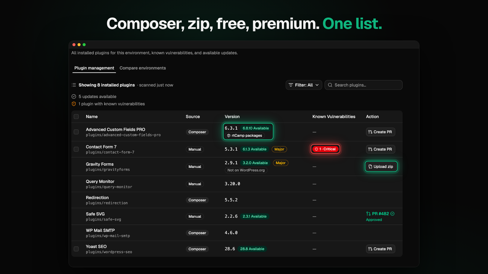

## Contents

- [Features](#features)
- [Requirements](#requirements)
- [Getting started](#getting-started)
- [Connecting GitHub](#connecting-github)
- [Adding a Wordfence API key](#adding-a-wordfence-api-key)
- [How updates work](#how-updates-work)
- [Where your data lives](#where-your-data-lives)
- [Troubleshooting](#troubleshooting)
- [Development](#development)

## Features

### Projects overview

All your projects in one table. Each environment tag shows how many updates are available and how many plugins have known vulnerabilities, from that environment's last scan. Click a tag to open the project with that environment selected.

- Environment tags are colored and ordered Production, Staging, Development, then any custom environments.
- Hover a tag to see its branch, counts and when it was last scanned.
- The Last scanned column shows how fresh each project's data is.

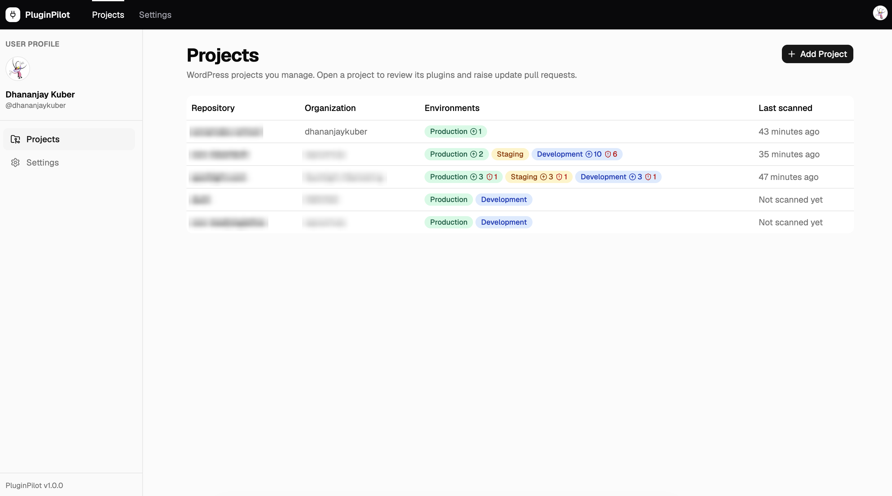

### Add a project in a few clicks

Pick any repository your GitHub account can push to. PluginPilot reads the default branch and detects:

- Plugin folders: `plugins/` (VIP), `wp-content/plugins/`, Bedrock's `web/app/plugins/` and others
- Composer: `composer.json`, `composer.lock`, the number of WordPress.org plugins and where Composer installs them
- Branches, used to suggest environments: `develop` → Development, `staging`/`preprod` → Staging, `main`/`master`/`production` → Production

Every suggestion can be edited before saving, and you can add your own environments (QA, UAT, …).

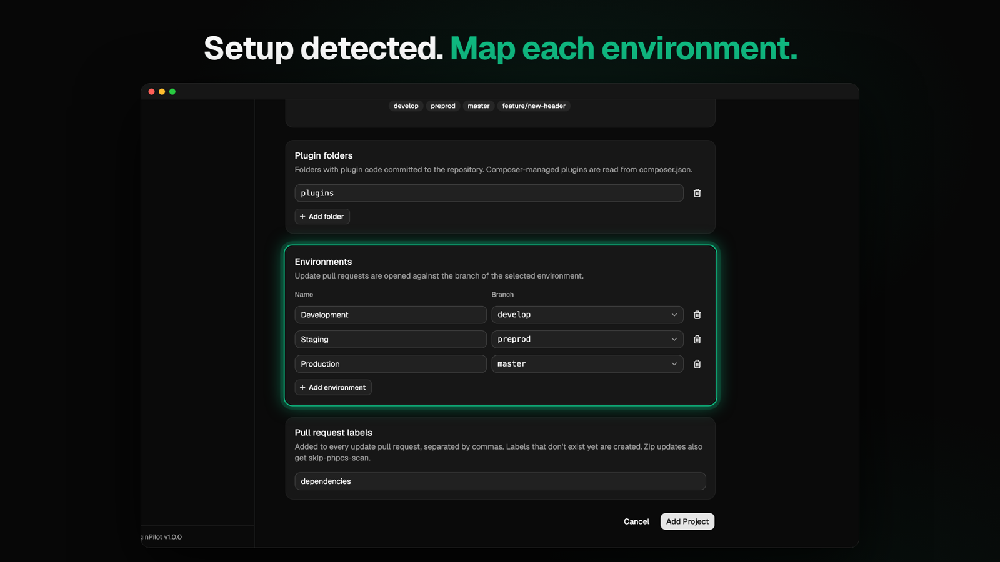

### Plugin scan per environment

Choose an environment and PluginPilot lists every plugin on its branch:

- **Committed plugins** (zip/code in the repository): name and version are read from the main plugin file header, the same way WordPress does.
- **Composer plugins**: read from `composer.lock`, only when they're required in `composer.json` and their code isn't committed. A committed plugin folder always wins, so a stale `composer.lock` can't mislabel plugins.
- Long names are shortened in the table, e.g. "CookieYes – Cookie Banner for Cookie Consent…" becomes "CookieYes". The full name is shown on hover.
- Search, and filter by **Updates available**, **Vulnerable**, **Not on WordPress.org** or **Open pull request**.

Scans are cached until you click **Scan**, because each one makes many GitHub API calls.


### Available updates

Latest versions come from WordPress.org:

- A green **"x.y.z Available"** pill shows next to outdated plugins.
- An amber **Major** badge flags big version jumps such as `5.x → 6.0`.
- Premium and custom plugins are marked **Not on WordPress.org**.

### Known vulnerabilities

With a free Wordfence Intelligence API key, every plugin is checked against the Wordfence vulnerability feed, including premium plugins. The **Known Vulnerabilities** column shows the number of issues and the highest severity. Hover the badge for each issue's title, CVSS score, CVE and the version that fixes it.

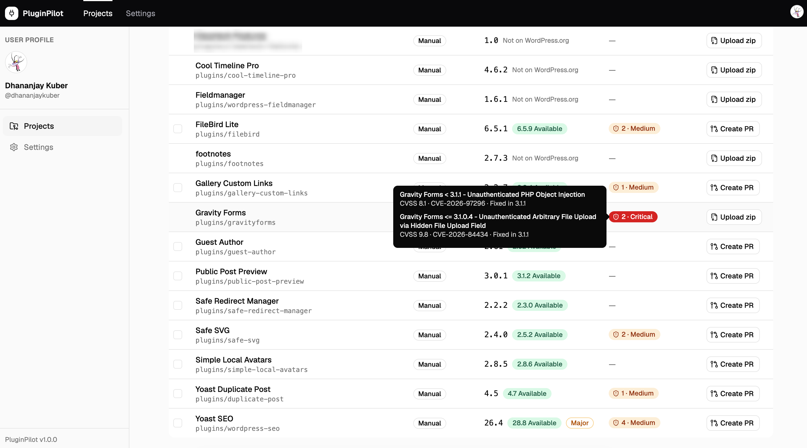

### Create PR

Click **Create PR** on a plugin to review the update before anything changes on GitHub:

- Version change, target environment and branch, new branch name and plugin folder (or Composer package)
- **What's new**: the WordPress.org changelog for only the versions you're skipping
- Notes for security fixes, major updates and the minimum WordPress and PHP versions
- **Local changes check**: the committed plugin folder is compared with the original WordPress.org zip of the installed version. If files were edited by hand, they're listed, and you must confirm before they're overwritten.

Then PluginPilot creates the branch `plugin-update/<base-branch>/<slug>-<version>` (for example `plugin-update/develop/wordpress-seo-28.8`) from the environment branch, commits the new version, and opens a pull request. The pull request description includes the version table, requirements, security fixes and changelog notes.

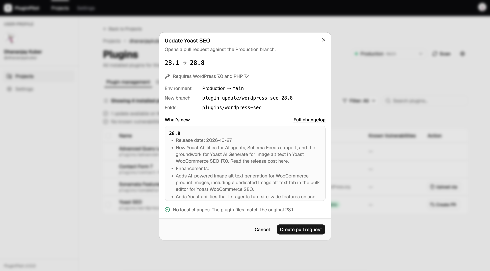

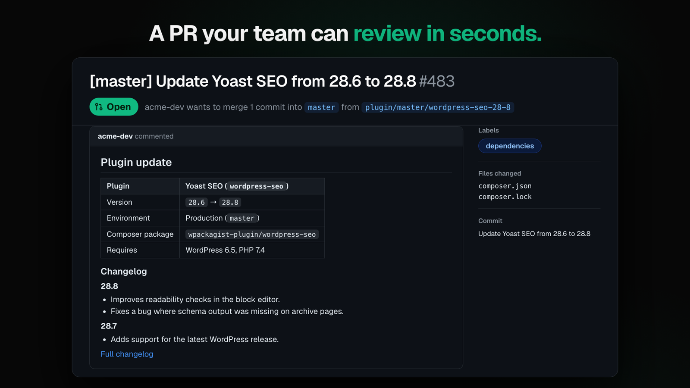

### Bulk pull requests

Tick several plugins, or use the header checkbox to select every visible plugin with an update, then click **Create N PRs**. PluginPilot opens one pull request per plugin, one after another, with live status for each.

- Plugins with hand-made changes are skipped, so nothing is overwritten without review.
- A failure only affects that plugin; the rest continue.

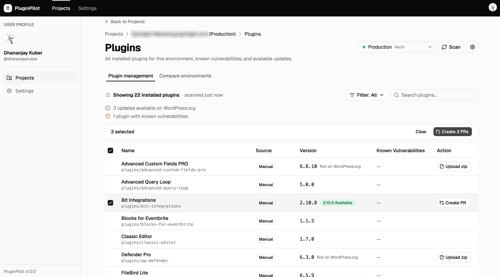

### Premium plugins: Upload zip

Plugins that aren't on WordPress.org (ACF Pro, Gravity Forms, …) get an **Upload zip** button. Download the new version from the vendor, choose the zip, and PluginPilot checks that it's the same plugin at a newer version before opening the pull request the usual way.

### Pull request status

Plugins with an open update pull request show **PR #N** instead of **Create PR**, so updates are never duplicated. Next to it:

- ✓ / ✗ / spinner for CI checks (GitHub Actions and classic commit statuses)
- **Approved** or **Changes requested** from reviews

The list refreshes when you switch back to PluginPilot and when you click **Scan**.

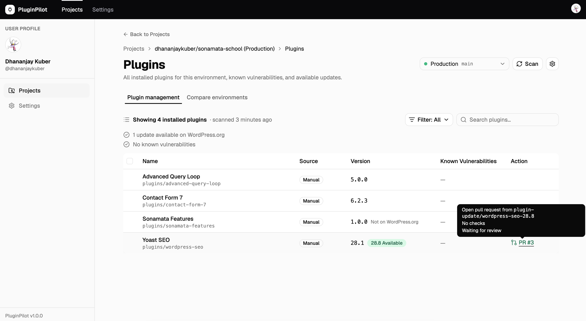

### Compare environments

The **Compare environments** tab shows every plugin's version on each environment side by side. Rows that differ are highlighted: the newest version in green, older ones in amber, and "Not installed" in grey. Turn on **Only show differences** to see what's tested on staging but not yet live. **Scan all** rescans every environment at once.

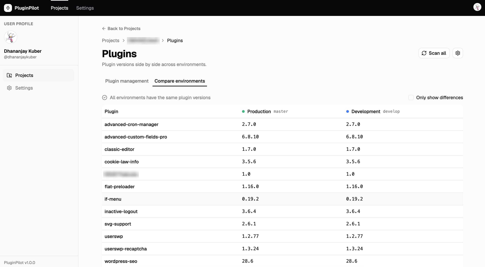

### Project settings

Edit a project's plugin folders and environment branches, or delete it from PluginPilot. Deleting never touches the GitHub repository. Open it with the ⚙ button next to **Scan**.

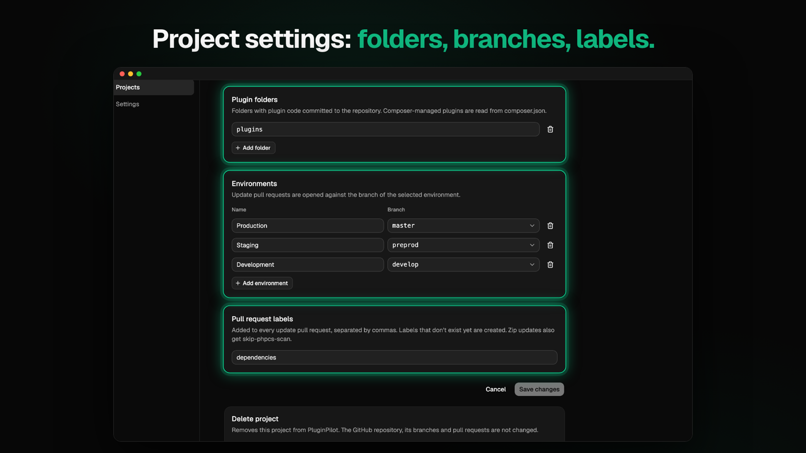

### Backup and restore

**Settings → Projects backup** exports all projects to a JSON file and imports them again, for a new Mac or to share your setup with a teammate. The file contains repositories, plugin folders and environments only, never your GitHub token or Wordfence key. Imports are validated first, and repositories you already have are skipped.


### Light and dark mode

Choose **Light**, **Dark** or **System** from the account menu (your avatar, top right). System follows macOS appearance.

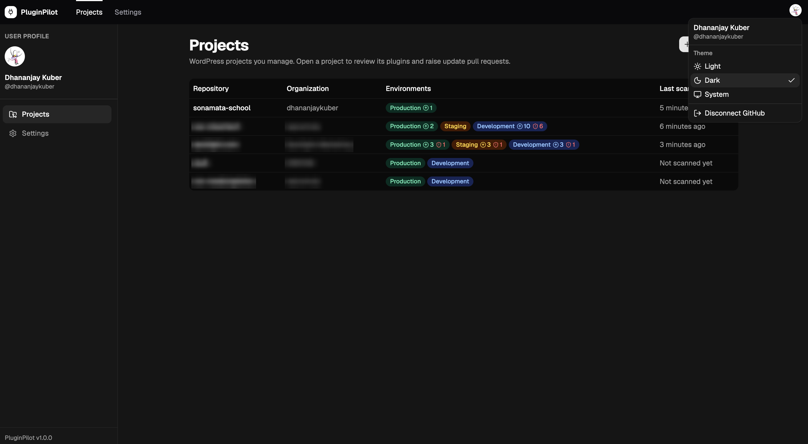

## Requirements

- **macOS** (Windows and Linux builds are possible but not tested yet)
- A **GitHub personal access token** (classic) with the `repo` scope
- Optional: a free **Wordfence Intelligence API key**, for vulnerability checks
- Optional: **PHP** and **Composer**, only to update Composer-managed plugins
- For development: **Node.js 22+** and npm

## Getting started

```bash
git clone https://github.com/dhananjaykuber/pluginpilot.git
cd pluginpilot
npm install
npm run dev
```

The app opens and asks you to connect GitHub. Then:

1. **Projects → Add Project**: pick a repository, check the detected setup and environments, and click **Add Project**.
2. Open the project, choose an environment and wait for the scan.
3. Click **Create PR** on a plugin with an update, or select several and click **Create N PRs**.

## Connecting GitHub

PluginPilot uses a personal access token, so it can reach every repository your account can, including organizations such as `wpcomvip` that don't allow installing GitHub Apps.

1. [Create a classic token](https://github.com/settings/tokens/new?scopes=repo&description=PluginPilot) with the **`repo`** scope. A 90-day expiration is recommended.
2. If your organizations use SSO, click **Configure SSO** next to the token on GitHub and authorize each organization. Otherwise their repositories won't appear.
3. Paste the token into PluginPilot.

The token is checked with GitHub, encrypted with the macOS Keychain, and stored only on your machine. If it expires or is revoked, PluginPilot signs you out and asks for a new one.

## Adding a Wordfence API key

1. Create a free account at [wordfence.com](https://www.wordfence.com/) and create an API key under **Account → Integrations**.
2. In PluginPilot, go to **Settings → Vulnerability data**, paste the key and click **Save**.

The vulnerability feed is downloaded once a day and cached on your machine. The first check after saving the key takes a little longer.

## How updates work

PluginPilot never clones repositories. Everything happens through the GitHub API:

| Plugin type | What the pull request changes |
|---|---|
| Committed plugin from WordPress.org | The plugin folder is replaced with the new zip. Only files that actually changed are sent, and files removed in the new version are deleted. |
| Composer plugin | Only `composer.json` and `composer.lock`. Composer runs locally with `--no-install` in a temporary folder; plugin code is not committed. |
| Premium plugin (Upload zip) | The plugin folder is replaced with the contents of the zip you choose. |

Every update gets its own branch, `plugin-update/<base-branch>/<slug>-<version>`, created from the selected environment's branch, and a pull request against that branch. Because the base branch is part of the name, the same update can be open for several environments at once.

## Where your data lives

Everything is stored locally in `~/Library/Application Support/PluginPilot/`:

- `pluginpilot.json`: projects, environments, last scan summaries, and the encrypted GitHub token and Wordfence key
- `wordfence-vulnerabilities.json`: the cached vulnerability feed

Deleting the app doesn't delete this folder, so reinstalling brings everything back. Use **Settings → Projects backup** to move projects to another Mac. Secrets are never exported; if they can't be decrypted on a new machine, PluginPilot simply asks for them again.

## Troubleshooting

**A repository is missing from Add Project.** Only repositories you can push to are listed. For organization repositories, check that the token is authorized for the organization's SSO.

**"Composer was not found."** Install PHP and Composer (for example with Homebrew). PluginPilot also looks in `/opt/homebrew/bin`, `/usr/local/bin` and Composer's global bin folder, even when launched from the Dock.

**A Composer update times out.** Package repositories such as wpackagist can be slow the first time. Click **Try again**; later runs are faster once Composer has cached the package index.

**A merged pull request still shows PR #N.** Switch back to PluginPilot or click **Scan**. Then scan again so the table shows the merged version.

**A plugin shows the wrong update.** Committed plugins are matched to WordPress.org by folder name. A custom plugin whose folder name matches a WordPress.org plugin will show that plugin's updates.

## Development

Built with Electron, React, TypeScript, Vite ([electron-vite](https://electron-vite.org/)), Tailwind CSS, [shadcn/ui](https://ui.shadcn.com/) on Base UI, TanStack Query and Octokit.

```bash
npm run dev          # Start the app; main and preload changes restart it automatically
npm run typecheck    # Type-check main, preload and renderer
npm run lint         # ESLint
npm run format       # Prettier
npm run build:mac    # Build a macOS app in dist/
```

### Project structure

```
src/
├── main/                 Electron main process
│   ├── ipc/              IPC handlers, one file per feature
│   ├── services/         GitHub, WordPress.org, Wordfence, Composer, scanning, updates
│   └── store.ts          Local storage (electron-store)
├── preload/              Exposes the typed window.api to the renderer
├── renderer/src/         React UI
│   ├── pages/            One component per screen
│   ├── components/       Feature components; ui/ holds generated shadcn components
│   ├── hooks/            Data hooks (TanStack Query) and UI state
│   └── lib/              Pure helpers: formatting, filters, form logic
└── shared/               Types, IPC contract and helpers used by both processes
```

The renderer never talks to GitHub or the file system directly. It calls `window.api`, defined once in `src/shared/ipc.ts`, and the main process does the work.

<!--
  Images: screenshots live in docs/images/. Crop them to the app window (no macOS title bar,
  menu bar or Dock) and blur client repository, organization and plugin names.
-->
